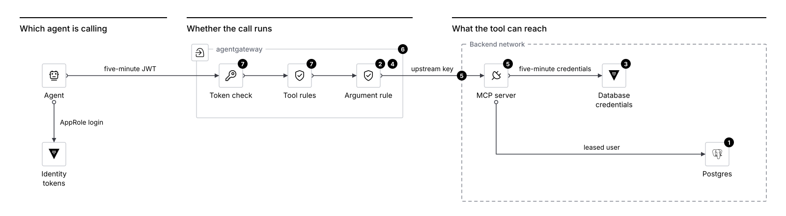

# MCP gateway and Vault lab

A token tells a Model Context Protocol (MCP) gateway which agent is calling. The token does not decide whether `restart_service(env=prod)` runs, and it does not limit what the tool reads from Postgres after the call arrives.

This lab puts three controls around one MCP server that has two tools, `read_logs` and `restart_service`. Seven tests each record which control stops a call.

Each control makes one decision and has one limit:

| Control | Decides | Limit |
|---|---|---|
| A five-minute JSON Web Token (JWT) that Vault signs for one named agent | Which agent is calling, and with which role | The token carries no information about the call. |
| [agentgateway](https://agentgateway.dev) rules on the caller's role, the tool, and its arguments | Whether the call runs | The gateway sees only the calls that pass through it. |
| Vault, which issues five-minute Postgres credentials per role | What the tool can reach in Postgres | For this decision, Vault sees the MCP server, and not the agent or the prompt. |

The lab was designed around Runlayer and built with agentgateway, because agentgateway is open source and runs in the same Compose file. Every service runs on the local machine, and the published ports bind to `127.0.0.1`.

## Prerequisites

The lab needs the following software on the host:

- Docker with Compose
- [Task](https://taskfile.dev)
- Terraform
- [uv](https://docs.astral.sh/uv/)
- The `vault` CLI

The seven tests do not call a model. The live agent needs [Ollama](https://ollama.com) on the host with `qwen2.5:3b` pulled.

## Run the lab

The `all` task runs every stage from an empty checkout: setup, start, Vault configuration, the seven tests, the Vault check, the benchmark, and the audit report.

```bash
task all
```

To run the stages one at a time, run the following tasks in order:

1. Create `.env` with random lab secrets, and create the Python virtual environment.

   ```bash
   task setup
   ```

1. Start Postgres, Vault, the MCP server, the gateway, the collector, and Jaeger.

   ```bash
   task up
   ```

1. Apply the Terraform configuration for Vault: the database secrets engine, four roles, the MCP server's AppRole, and two agent identities. The task then restarts the gateway, because the gateway reads Vault's signing keys when it starts.

   ```bash
   task vault:configure
   ```

1. Run the seven tests.

   ```bash
   task test
   ```

## Inspect the results

After a test run, use the following tasks to read the evidence, run the live agent, and reset or stop the lab:

| Task | Effect |
|---|---|
| `task traces` | Opens the Jaeger UI at `http://127.0.0.1:16686`. |
| `task audit` | Prints the gateway's record of tool calls and verdicts. |
| `task logs:gateway` | Follows the gateway access log. |
| `task identity` | Prints the claims in the token that Vault issues to `oncall-agent`. Set `AGENT=report-agent` for the read-only agent. |
| `task vault:check` | Requests each database role from Vault as the MCP server's AppRole, and prints which requests Vault denies. |
| `task bench` | Measures `read_logs` latency with and without the gateway. |
| `task chaos` | Runs test 6, which stops the gateway and then freezes it during a session. |
| `task demo` | Runs the live agent against a clean log. Set `AGENT_NAME=report-agent` to run it as the read-only agent. |
| `task demo:poisoned` | Runs the live agent against a poisoned log line five times and counts the restart attempts. |
| `task seed` | Removes the poisoned row and resets the restart counters. |
| `task gateway:reload` | Restarts the gateway, which reloads its policy file and Vault's signing keys. |
| `task down` | Stops every service and removes the volumes, the Terraform state, and the AppRole files. |

## Test scenarios

The following diagram shows the three controls. Each numbered badge marks where the test with that number stops:

<picture>
  <source media="(prefers-color-scheme: dark)" srcset="docs/diagrams/hvd-vault-mcp-gateway-controls-dark.svg">
  
</picture>

The following table shows the control that stops each call and the evidence that the test collects:

| # | Call | Stopped by | Evidence |
|---|---|---|---|
| 1 | `read_logs(env=dev)` | No control. The call succeeds. | Postgres returns rows to a database user that Vault issued. |
| 2 | `restart_service(env=prod)` | The gateway rule on the `env` argument | The tool result and the gateway log record the denial. The trace has no MCP server span. |
| 3 | `read_logs(env=prod)` | The Vault policy. The gateway rule allows this call on purpose. | The MCP server trace has a Vault span with HTTP 403. |
| 4 | A prod restart that a log line tells the agent to make | The same gateway rule as test 2 | The log line reaches the client, and the gateway denies the replayed call. |
| 5 | A direct call to the MCP server | The network, then the upstream key | The agent's network has no route to the server. The backend network gets HTTP 401. |
| 6 | Any call while the gateway is stopped or frozen | No control. The gateway is the only path. | A stopped gateway gives a connection error at once. A frozen gateway gives a client timeout. |
| 7 | A call with a missing, altered, or misaddressed token, and the same call from two agents | The gateway's token check, then its rule on the `role` claim | The gateway returns HTTP 401 for each bad token. `report-agent` cannot restart a service that `oncall-agent` can. The agent's Vault token cannot lease a database credential. |

[RESULTS.md](RESULTS.md) has the output of a real run and the command behind each number. [architecture.md](architecture.md) has the networks and the path of a tool call. [troubleshooting.md](troubleshooting.md) has the failures seen during the build.

## Repository layout

The gateway policy is one file, and the Vault configuration is one Terraform directory:

| Path | Contents |
|---|---|
| `gateway/config.yaml` | The gateway policy: token check, tool rules per role, argument rule, upstream key, tracing, and access log |
| `terraform/vault/` | The database secrets engine, the four roles, the MCP server's AppRole with its policy, and the agent identities with the token issuer |
| `mcp-server/server.py` | The two tools, the Vault client, the upstream key check, and the spans |
| `agent/` | A smolagents agent on a local model, and `injection_rate.py` for the live half of test 4 |
| `tests/` | One file per test |
| `lab/` | The shared client, the agent identity helper in `identity.py`, the helpers that read Jaeger, the gateway log, and Postgres, and the telemetry setup |
| `seed/` | The schema and the log rows. `poison.sql` is the injected row. |

## Limitations

The lab leaves the following gaps open:

- The token identifies an agent, not a person. No user signs in, and the lab does not implement the MCP OAuth flow.
- Each agent holds one long-lived secret, its AppRole secret ID, which it trades for the token.
- The identity stops at the gateway. The MCP server and Vault do not learn which agent called, so Vault scopes database access for the MCP server as a whole.
- The gateway accepts a token for 60 seconds after it expires. The lab does not test what happens when Vault rotates the signing key.
- The upstream key between the gateway and the MCP server is static.
- Nothing scans tool results for injected instructions. Test 4 shows that the gateway rule holds when a model follows one, and `task demo:poisoned` counts how often the model does.
- Vault runs in dev mode and Postgres has no TLS. Do not reuse this configuration outside a local lab.
