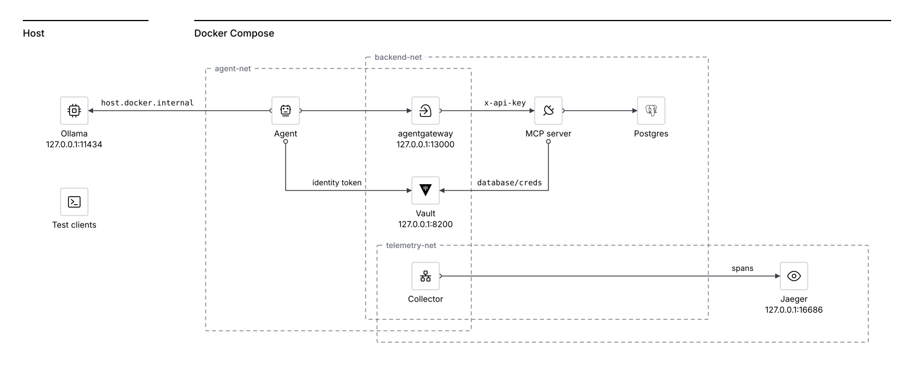
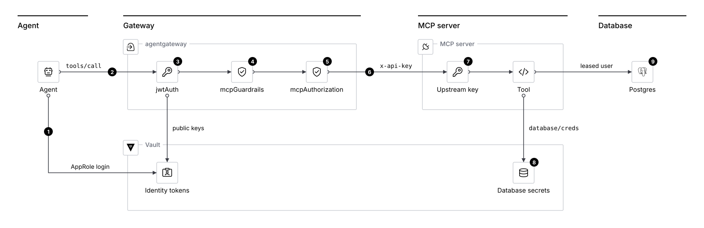

# Architecture

The model and the test clients run on the host. Every other component runs in Docker Compose on three networks, and the gateway is the only route from the agent to the Model Context Protocol (MCP) server.

## Component layout

The following diagram shows the network that each component joins and the ports that the lab publishes on the host:

<picture>
  <source media="(prefers-color-scheme: dark)" srcset="docs/diagrams/hvd-vault-mcp-gateway-component-layout-dark.svg">
  
</picture>

A component inside more than one network boundary joins each of those networks. An address under a component is the port that the lab publishes on the host. The MCP server and Postgres are not published.

## Request flow for one tool call

The following diagram shows the path of one tool call. Each numbered badge matches a step in the list after the diagram:

<picture>
  <source media="(prefers-color-scheme: dark)" srcset="docs/diagrams/hvd-vault-mcp-gateway-request-flow-dark.svg">
  
</picture>

The components handle one tool call as follows:

1. The agent logs in to Vault with its own AppRole and requests an identity token. Vault signs a JSON Web Token (JWT) that names the agent's entity in `sub` and `agent`, carries its `role`, has the gateway as its audience in `aud`, and expires after five minutes.
2. The agent sends `tools/call` to the gateway over streamable HTTP, with the JWT as a bearer token.
3. The gateway checks the token with `jwtAuth` in strict mode: the signature against Vault's public keys, the issuer, the audience, and the expiry. A request that fails a check gets HTTP 401 and goes no further.
4. The gateway runs the `mcpGuardrails` request processor. The processor rejects `restart_service` with `env == 'prod'`, and the agent gets a tool result with `isError: true` and the rejection text.
5. The gateway checks the tool against `mcpAuthorization`, which reads the `role` claim. A tool that the caller cannot use does not appear in `tools/list`, and a call to it by name gets HTTP 400.
6. The gateway forwards the call to the MCP server with the upstream key in `x-api-key` and the W3C trace context.
7. The MCP server rejects a request without the upstream key with HTTP 401.
8. The tool logs in to Vault with the MCP server's AppRole, caches the token, and requests `database/creds/<role>-<env>`. The AppRole policy allows the two dev roles only, so Vault answers a prod request with HTTP 403 and the tool returns an error.
9. The tool opens a Postgres connection as the leased user, runs one statement, and returns the result.

## Decision points by layer

No layer sees the whole call. Each one decides on what it can see:

| Layer | Configured in | Sees | Does not see |
|---|---|---|---|
| Gateway | `gateway/config.yaml` | The caller's verified claims, the tool name, the arguments, and the result | What the tool does with its backend |
| MCP server | `mcp-server/server.py` | Whether the request carries the upstream key, which only the gateway adds | The original caller |
| Vault | `terraform/vault/main.tf` | Which agent requests an identity token, and which workload requests which database role | The prompt, the tool call, and which agent is behind a database request |
| Postgres | Grants in the Vault role | The leased user and its grants | The layers that come before it |

## Gateway rule types

`mcpAuthorization` decides which tools exist for a caller, from the tool name and the caller's claims. It cannot read tool arguments. A rule on an argument is an `mcpGuardrails` processor, which runs in the request phase before the gateway contacts the MCP server.

The lab uses both. `mcpAuthorization` allows `read_logs` for every agent and `restart_service` for the `operator` role. An `mcpGuardrails` processor denies `restart_service` when `env` is `prod`, for every role.

## Networks

The agent container joins `agent-net` only, so it cannot resolve or route to the MCP server or Postgres. The collector is the only service on all three networks.

Vault joins `agent-net` and `backend-net`, because agents must log in to it to get an identity token. An agent's Vault policy allows identity token requests and no database path.

The first Compose file put the agent and the MCP server on a shared telemetry network, and the agent could then call the server without the gateway. Do not put the agent and the MCP server on a shared network, including one that you add for observability, because any shared network is a route around the gateway.

The host is an exception to this isolation. The agent reaches Ollama through `host.docker.internal`, so it can also reach the other ports that the lab publishes on the host: Vault on 8200 and the gateway on 13000. The agent's Vault token can request an identity token only and the MCP server port is not published, but a stricter setup runs the model inside `agent-net`.

## Traces and audit

The agent, the gateway, and the MCP server export spans to the collector, which forwards them to Jaeger. The gateway continues a `traceparent` that the client sends and forwards it to the MCP server, so one agent run is one trace.

MCP server spans carry two attributes for the tests. `lab.decision` is `allow` or `deny`, and `lab.layer` is `none`, `vault`, or `header`.

A call that the gateway denies has no MCP server span, because the call never reaches the server. The evidence for a gateway denial is the gateway span and the gateway's request log.

The request log is JSON on the gateway's standard output. Each entry has the agent name, role, and Vault entity ID from the verified token, the tool, the arguments, any error, and the trace ID. You can match a log entry with its trace by that ID.
